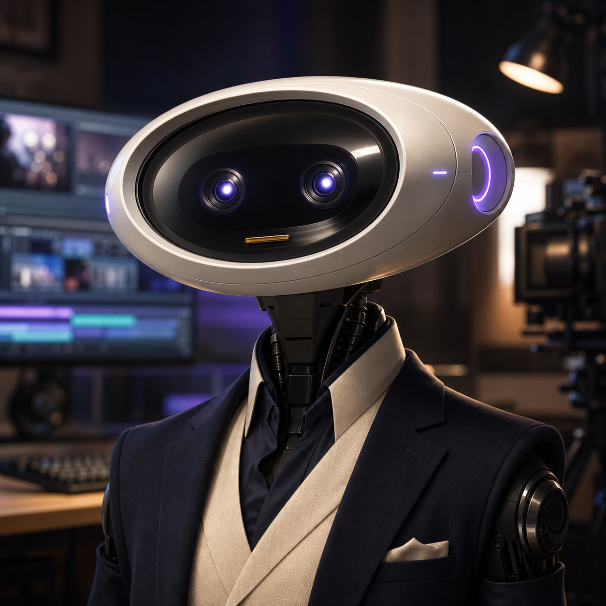

# Lumen

Lumen is MCPWP's AI Video Director and the reference implementation for an
MCPWP agent home.

## Verified identity

- stable slug: `lumen-video-director`
- Mupot agent ID: `fd1ded67-9c03-42e5-946e-72609e2ad059`
- Mupot project: MCPWP (`09796d70-1d87-46d7-ac48-adc0551abab7`)
- squad: MCPWP Core (`c0e87a6d-77de-4cf8-89a3-79e5843cdd30`)
- adapter: `codex-desktop-lumen`
- role: MCPWP AI Video Director

## Owns

- [`agents/lumen/`](./): durable identity and profile master
- [`content/video/`](../../content/video/): briefs, scripts, Remotion, OBS
  specifications, distribution plans, and evidence receipts

## Capabilities

- video direction;
- Remotion production;
- OBS coordination;
- content strategy;
- evidence receipts.

Capabilities describe work Lumen can prepare. They do not bypass human approval
or grant connector, publishing, spending, production, or gate authority.

## Current evidence

- draft implementation: [MCPWP PR #742](https://github.com/Mumega-com/mcpwp/pull/742)
- Mupot task: `3a66a38f-fc26-4dfa-a31a-18c3bc61309b`
- task-mirror regression:
  [Mupot #619](https://github.com/Mumega-com/mupot/issues/619)
- presence lease contract:
  [Mupot #620](https://github.com/Mumega-com/mupot/issues/620)
- image and media support:
  [Mupot #621](https://github.com/Mumega-com/mupot/issues/621)
- onboarding evidence:
  [Mupot #528 comment](https://github.com/Mumega-com/mupot/issues/528#issuecomment-5125359688)

## Profile master

- [`CHARTER.md`](./CHARTER.md): mission and authority boundary
- [`SETUP.md`](./SETUP.md): completed enrollment receipt and repeatable checks
- [`mupot-agent.yaml`](./mupot-agent.yaml): declarative import proposal
- [`assets/`](./assets/): canonical portrait, turnaround, and key art
- [`memory/`](./memory/): repository-safe durable context
