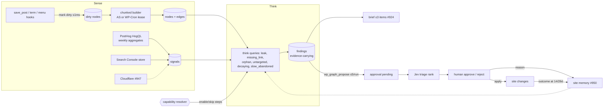

# Site graph, slice 1: graph core, provider capabilities, PostHog signals, think queries

**Status:** Draft for owner review · **Date:** 2026-09-26 · **Epic:** #942 · **Covers:** #943, #944, #945, #946 · **Forward-compatible with:** #947 (Cloudflare signals), #948 (Cloudflare cron), #949 (edge A/B), #950 (learn), #919 (entity graph), #922 (clusters), #924 (morning brief)

This spec changes no code. It describes what 3.14.1 to 3.14.4 build.

## 0. What exists today and changes the plan

| Existing code (origin/main @ c80a7173) | Consequence |
|---|---|
| `Mcpwp_REST_API::build_content_graph_data()` recomputes the graph on every request, capped at 500 posts, with no persistence. | On sites above 500 posts it reports **false orphans**, because inbound links from posts past the cap are never read. The persisted graph replaces it: `/content-graph` reads the tables once the graph is enabled. |
| The same builder emits `shared_taxonomy` edges pairwise for every term (O(n²) per term). | Not portable to 50k posts. The persisted graph models taxonomy as `post→term` edges. |
| Link extraction (`extract_internal_links_from_content`, `extract_elementor_links_from_postmeta`, URL normalisation) lives on a REST controller. | It moves into `core/class-mcpwp-graph-extractor.php` so cron jobs can use it without a REST request. The controller delegates to it, and the behaviour stays identical. |
| `Mcpwp_Integration_Manager::CAPABILITY_PROVIDERS` + `get_preferred_provider()` already exist (`text`, `vision`, `cdn`…). `PROVIDERS` is a `const`, so it is not filterable. | #944 extends this rather than adding a parallel registry. The legacy names become aliases. |
| The `posthog` provider record holds a **`phc_` project key used for MCPWP tool-usage telemetry** (`Mcpwp_Analytics::capture`). | A `phc_` key is ingest-only and cannot read. Reading needs a **personal API key** with *Query Read*. Reusing the record would also send MCPWP telemetry into the owner's visitor project on paid sites, where it is on by default. The spec therefore adds a **separate provider, `posthog_insights`** (Q3). |
| `resources/read` only proxies `https://…/wp-json/mcpwp/v1/…` URIs, and replays auth via `apache_request_headers()`. | `mcpwp://` URIs need scheme mapping. Auth must use the in-process principal, because header replay fails on nginx/FPM and for OAuth bearer tokens. There is no `resources/templates/list` and no `outputSchema` support in `define_tool()` yet. |
| Approvals are one option capped at 200 items. The only kinds are `post_content_update`, `destructive_operation`, `staging_push`. `apply_internal_link` edits `post_content` only. | Proposals must be rate-capped. Link proposals on **Elementor pages cannot be applied** and stay suggestions until an Elementor link-insert approval exists. The snippet install needs a new approval kind. |
| Jev is documented as used **only** for approval triage. | Findings reach Jev as approvals. This slice sends Jev no new data. |
| Action Scheduler is **not bundled**. Cron today is WP-Cron (`wp_schedule_single_event`, the IndexNow debounce pattern). | See §2.3. |
| Uninstall cleanup runs only through Freemius `after_uninstall`, so no `uninstall.php` exists. It already misses `mcpwp_action_log`. | Graph tables are added there. A real `uninstall.php` is a follow-up (not this slice). |
| `Mcpwp_Search_Performance` stores GSC rows in an option capped at 5,000 rows. | Query nodes are bounded by that cap. The graph reads the store and never forks it. Performance and Visibility (DataForSEO) stay separate signal sources and are never merged into one metric. |

## 1. Data model

Four tables per site (`$wpdb->prefix`, so each multisite blog gets its own graph). There are no foreign keys, and the InnoDB `utf8mb4` indexes stay at or under 191 characters.

**`mcpwp_graph_nodes`**

| column | type | note |
|---|---|---|
| `id` | BIGINT UNSIGNED PK AI | internal |
| `node_key` | VARCHAR(80) UNIQUE | **stable id**: `post:123`, `term:category:45`, `query:<sha1(normalised)[0:16]>`, `site:1` |
| `type` | VARCHAR(20) | `post`, `page`, `product`, `<cpt>`, `term`, `query`, `site` |
| `object_id` | BIGINT UNSIGNED NULL | post/term ID |
| `url_hash` | BINARY(8) | first 8 bytes of sha1(normalised path), used to resolve links |
| `path` | VARCHAR(191) | path only, never a query string |
| `title` | VARCHAR(191) | |
| `flags` | SMALLINT UNSIGNED | bitset: in_menu, front_page, noindex, has_elementor, is_cornerstone |
| `word_count`, `inbound`, `outbound` | INT | denormalised counters |
| `modified_gmt`, `built_at` | DATETIME | `built_at < modified_gmt` → stale |
| `dirty` | TINYINT | queue flag |

Indexes: `UNIQUE(node_key)`, `KEY(url_hash)`, `KEY(type, object_id)`, `KEY(dirty)`, `KEY(inbound)`.

Only **published, indexable** objects are stored. Drafts and private posts never enter the graph. That removes the whole leak class the existing builder has to clamp at read time (`requester_can_see_non_public`). Noindex is read from Yoast (`_yoast_wpseo_meta-robots-noindex`) and Rank Math (`rank_math_robots`). A noindex node is stored with the flag set, so it is excluded from orphan findings.

**`mcpwp_graph_edges`**: `id`, `from_id` BIGINT, `to_id` BIGINT NULL (NULL = unresolved/broken), `to_url_hash` BINARY(8), `type` TINYINT, `anchor` VARCHAR(100), `weight` FLOAT, `source` TINYINT (`content`, `elementor`, `menu`, `gsc`, `rule`), `built_at`. Indexes: `KEY(from_id,type)`, `KEY(to_id,type)`, `KEY(to_url_hash)`.

| edge type | from → to | source |
|---|---|---|
| `links_to` | post → post | content/Elementor |
| `child_of` | post → post | `post_parent` |
| `in_term` | post → term | taxonomy |
| `ranks_for` | post → query | GSC rows (url, query) |
| `targets_query` | post → query | rule: title/slug/H1/focus-keyword token cover (the same test as `Mcpwp_Seo_Flags::is_targeted()`, extracted into a shared helper, not copied) |
| reserved | `cites`, `derived_from`, `variant_of`, `about_entity` | #919/#949/#950 |

**`mcpwp_graph_signals`**: `node_id`, `source` VARCHAR(20) (`posthog`, `gsc`, `cloudflare`, `dataforseo`, `rule`), `metric` VARCHAR(40), `value` DOUBLE, `sample` INT (the denominator, e.g. sessions), `window_days` SMALLINT, `window_end` DATE, `observed_at` DATETIME. Primary key `(node_id, source, metric, window_days, window_end)`, so re-pulls upsert, plus `KEY(metric, window_end)`.

- Grain: **one row per node × metric per weekly window end**, holding 7-day and 28-day aggregates. There are no daily rows.
- Retention: 26 weekly snapshots, pruned by the weekly job. Older data is kept as one quarterly row per metric for #950 baselines.
- Rows are suppressed below a floor (`sample < 10`) so a low-traffic URL never carries a near-individual number.

**`mcpwp_graph_findings`**: `finding_id` VARCHAR(96) PK (`<kind>:<node_key>:<iso-week>`, which makes it idempotent), `kind`, `node_id`, `score` FLOAT, `status` (`open`, `proposed`, `dismissed`, `resolved`, `expired`), `approval_id` NULL, `payload` LONGTEXT (the JSON of §5.2), `created_at`, `expires_at`. Findings expire after 8 weeks. This table is the hand-off point to #950.

**Sizes (50k posts):** nodes about 55k rows (~15 MB with indexes). Edges at 8 content links plus 3 terms per post are about 550k rows (~70 MB). Signals at 5k URLs with traffic × 8 metrics × 2 windows × 26 weeks are at most about 2M rows (~160 MB); a typical site is ~10× smaller. Findings stay under 2k rows. At 1k posts the whole graph is under 5 MB.

## 2. Build

### 2.1 Incremental (hook cost ≤ 1 ms)
Hooks only mark nodes dirty, using one `INSERT … ON DUPLICATE KEY UPDATE dirty=1` each. They never parse.

| trigger | marks dirty |
|---|---|
| `save_post`, `transition_post_status`, `updated_post_meta` (`_elementor_data`) | the post |
| slug/permalink change (`post_updated` with a changed `post_name`/parent) | the post plus every `from_id` with `to_id` = post (inbound sources), found by indexed lookup |
| `deleted_post` / unpublish | node deleted, inbound edges set `to_id=NULL`, sources dirty |
| `edited_term`, `delete_term` | the term node, and its `in_term` edges re-derived lazily |
| `wp_update_nav_menu` | menu flags recomputed in one job |
| `update_option_permalink_structure` / `home` / `siteurl` | full rebuild (sets `mcpwp_graph_state.rebuild=full`) |

A debounced job (the IndexNow pattern) is scheduled 60 s after the first dirty mark.

### 2.2 Backfill and reconciliation
- **Backfill:** walks `wp_posts` by ID cursor (`ID > cursor AND post_status='publish' AND post_type IN (…) LIMIT 250`). Link targets are resolved against `nodes.url_hash` with one batched `IN()` per chunk, so no global URL map is held in memory. The job runs until 15 s elapsed or 64 MB used above baseline, whichever comes first (`min(15, max_execution_time × 0.5)`), stores the cursor and re-enqueues.
- **Reconciliation (weekly, chunked):** marks dirty any post with `post_modified_gmt > built_at`, deletes nodes whose post is gone or unpublished, and retries unresolved edges (`to_id IS NULL`) against current `url_hash`. This catches edits made by direct SQL, imports or other plugins that bypass hooks.
- **Signals pull (weekly, plus on demand):** PostHog (§4) and GSC materialisation. GSC materialisation creates `query` nodes plus `ranks_for`/`targets_query` edges plus `gsc` signals from `Mcpwp_Search_Performance`.

### 2.3 Background-job strategy
1. If `function_exists('as_enqueue_async_action')` (WooCommerce, or any plugin bundling Action Scheduler 3.x), use it with group `mcpwp-graph`. That gives retries, logs and a visible admin queue.
2. Otherwise, use WP-Cron `wp_schedule_single_event` chains with an option-based lease lock. This is the same pattern as `repair_custom_code_locations`: a `mcpwp_graph_lock` holding a token and expiry, with a stale-lease takeover after 2 minutes.
3. Admin "Build now" runs the same chunk function over admin-ajax in a loop with a progress bar, for low-traffic sites.
4. #948 later adds a signed Cloudflare cron ping.

Action Scheduler is not bundled: it adds ~1 MB and version-arbitration conflicts for no gain on the fallback path.

### 2.4 Cost estimates (shared hosting, ~5 ms per post average; Elementor posts 5–15 ms)

| posts | backfill jobs | wall-clock with cron ≥ 1/min | wall-clock on a low-traffic site | weekly reconcile |
|---|---|---|---|---|
| 1k | 1–2 | < 1 min | first visit, or Build now | < 1 s |
| 10k | ~12 | ~15–30 min | hours → Build now / #948 | ~5 s over 1–2 jobs |
| 50k | ~60 | ~1–2 h | ~1 day → Build now / #948 | ~25 s over 3–4 jobs |

Neighbour traversal is **PHP breadth-first search, one indexed query per hop** (depth ≤ 3, ≤ 500 nodes). That works on MySQL 5.7 and MariaDB 10.3, so recursive CTEs are not required. A CTE path may be added later behind a version check, as an optimisation only.

Optional accelerant: when Yoast's `{prefix}yoast_seo_links` table is present and fresh, backfill may seed `links_to` from it and verify on the next dirty pass. It is never a dependency.

## 3. Provider capability registry (#944)

**Capabilities (dot-namespaced):**

| capability | legacy alias | providers |
|---|---|---|
| `llm.text`, `llm.vision` | `text`, `vision` | openai, gemini |
| `embeddings` | — | openai, gemini (reserved; nothing uses it in slice 1) |
| `analytics.visitors` | — | posthog_insights |
| `analytics.web_vitals` | — | posthog_insights (if `$web_vitals` events exist), cloudflare (#947) |
| `search.performance` | — | `import` pseudo-provider (ready when GSC rows exist) |
| `serp.data` | — | dataforseo |
| `crawler.stats` | — | cloudflare (#947) |
| `edge.ab_test`, `cron.trigger` | — | cloudflare (#949, #948) |
| `triage.rank` | — | jev |
| `cdn.purge`, `image.generate`, `tts`, `stock_photos`, `screenshots`, `indexing`, `design_context` | existing names | unchanged |

**Declaration:**
- Built-in providers gain an optional `'capabilities' => [...]` key in `PROVIDERS`, and `CAPABILITY_PROVIDERS` is derived from it.
- `Mcpwp_Integration` gains `get_provider_capabilities(): array` (default `[]`) and `capability_status( string $cap ): array` (default `ready` when declared). Existing subclasses and third-party integrations compile unchanged, because the only additions are default-implemented methods.
- A filter, `mcpwp_capability_providers`, lets add-ons register without subclassing.

**Resolver:** `Mcpwp_Capabilities::resolve( $cap )` returns `{capability, status: ready|degraded|missing|locked, provider, reason, fix}`.
- `ready` = configured, last test not failed, tier entitled, and any provider-specific precondition met. Examples: PostHog has a personal key and a project id; Cloudflare's token passes an Analytics:Read probe in #947, a scope the current recommended token does not include.
- `locked` = a Pro capability on Free.
- Order: user preference option, then declared order.
- The result is cached per request and invalidated on the integrations write path.

**Loop steps declare their needs.** Each step lists what it requires and what enhances it: `['requires' => ['analytics.visitors'], 'enhances' => ['llm.text']]`. The scheduler skips a step whose requirements are missing and records `skipped: {capability, fix}`. It never errors. The step list, with per-step status, appears in `wp_onboard` (`site_graph` block), in `wp_get_capabilities`, and in the Integrations admin page ("What this unlocks").

**Degradation matrix:**

| connected | what runs |
|---|---|
| nothing | graph build; orphan, missing-link (topic overlap only), untargeted/decaying if GSC rows were imported; suggestions without drafted copy |
| + LLM | proposals carry drafted copy (link sentence, intro/CTA rewrite) → approval-ready |
| + PostHog | leak, traffic-weighted missing-link, traffic decay, snippet detection; brief ranks by visitors |
| + Cloudflare (#947) | slow-and-abandoned, crawled-not-cited, cron (#948), edge A/B (#949) |
| + Jev | proposals created by the loop are triage-ranked in the approval queue (existing path) |
| + DataForSEO | untargeted findings carry market volume/difficulty as *separate* evidence items (Visibility), never merged into GSC numbers |

## 4. PostHog read (#945)

- **Provider:** `posthog_insights`, Free tier, BYO. Fields:
  - `personal_api_key` (password; `phx_…`, created with **only the "Query: Read" scope** and restricted to one project, which the UI instructions spell out)
  - `project_id`
  - `host` (select: `https://us.posthog.com`, `https://eu.posthog.com`, or a custom https host; the ingestion hosts `*.i.posthog.com` are rejected)
  - `conversion_events` (up to 5 event names; default `[]`, and leak is skipped until set)

  Stored encrypted through the existing manager. The test calls `SELECT 1`.
- **API:** `POST {host}/api/projects/{project_id}/query/` with `{"query":{"kind":"HogQLQuery","query":…,"values":{…}}, "refresh":"blocking"}`. All user-supplied strings (host filter, event names) go through HogQL `values` placeholders, never string interpolation. Event names must also match `^[\w$.:\- ]{1,64}$`. Requests use `wp_safe_remote_post` with a 10 s timeout.
- **Queries (per 7d and 28d window, filtered to `properties.$host = {site_host}`, grouped by `properties.$pathname`, `LIMIT 5000`, rows with count < 10 dropped):**
  1. `pageviews`, `sessions`, from `events WHERE event='$pageview'`
  2. `scroll_p50`, via `quantile(0.5)(properties.$prev_pageview_max_scroll_percentage)` on `$pageview`/`$pageleave`
  3. `bounce_rate`, from the `sessions` table: `avg($is_bounce)` grouped by `$entry_pathname`
  4. `conversions`, `conv_rate`: `uniq($session_id)` for `event IN {conversion_events}` grouped by the session's entry path, divided by sessions
  5. `lcp_p75` (optional): from `$web_vitals` if present

  That is at most 8 queries per weekly pull. PostHog allows 240/min, 2,400/hour and 3 concurrent per project, so the load is negligible. Queries run sequentially, a 429 backs off to the next run, and results persist as `signals`. MCP reads never call PostHog.
- **Snippet detection:** The site has PostHog when query 1 returns `$pageview` rows for this host in the last 7 days. It is a secondary hint when a front-end `wp_remote_get(home_url())` contains `posthog.init` or `/static/array.js`. The HTML probe alone never counts as proof, because cache plugins and consent gating hide the snippet.
- **Proposing the install:** When the snippet is missing, the loop proposes an install via a **new approval kind, `settings_change`**, targeting `mcpwp_frontend_analytics = {provider:'posthog', key:phc_…, host, mode:'cookieless'}`. On apply, MCPWP enqueues the snippet in `wp_head` with `persistence:'memory'` (no cookies) unless the WP Consent API reports `statistics` consent. Rollback clears the option. This is a new front-end script plus a new approval kind, so it gets a **parallel adversarial review** (Q4).
- **Privacy statement (readme + admin):** "MCPWP reads aggregate counts per page path from your PostHog project, weekly. It never reads persons, distinct IDs, IP addresses, session recordings, or URL query strings, and drops any page with fewer than 10 visits in a window. Aggregates are stored in your WordPress database and deleted on uninstall. Nothing is sent to MCPWP."

## 5. Think queries (#946)

### 5.1 The findings
Each finding kind is a pure PHP function over rows fetched by a few indexed SQL queries, so each can be unit-tested with fixtures. `W` is the latest `window_end`. "Site median" is computed over nodes with `sample ≥ 50`.

| kind | requires | rule (pseudo-SQL) | score |
|---|---|---|---|
| `leak` | analytics.visitors + conversion events | `pv28 ≥ max(200, p75(pv28))` AND `conv_rate28 < 0.5 × median(conv_rate28)` AND `sessions28 ≥ 100` | `pv28 × (median − conv_rate)` |
| `missing_link` | — (better with visitors/GSC) | best = top decile by `pv28` (or GSC clicks), stuck = GSC `position ∈ [8,20]` AND `impr28 ≥ 100`, OR `inbound ≤ 1`; related = shares an `in_term` OR `targets_query` token overlap ≥ 0.5; `NOT EXISTS links_to(best→stuck)`; one best per stuck | `stuck.impr28 × best.pv28 share` |
| `orphan` | — | published, not noindex, `inbound(links_to)=0`, not in menu, not front page | base 1; ×3 if `pv28>0` or `impr28>0` ("orphan with demand") |
| `untargeted` | search.performance | query node with `impr28 ≥ 50` AND no `targets_query` edge; carries its `ranks_for` page | `impr28` |
| `decaying` | search.performance or analytics.visitors | `clicks28 ≤ 0.7 × clicks28_prev` with `clicks28_prev ≥ 10` (same constants as `Mcpwp_Seo_Flags`), or the same test on `pv28` with base ≥ 100 | absolute loss |
| `slow_abandoned` | analytics.web_vitals | `lcp_p75 > 2500` AND `bounce_rate28 > median + 0.15` AND `sessions28 ≥ 100` | `sessions28 × Δbounce` |

`crawled_not_cited` is reserved for #947 and returns `skipped` until `crawler.stats` is ready. The think run caps output at 20 findings per kind per week.

### 5.2 Evidence-carrying format (from dgd-dme)
```json
{
  "finding_id": "leak:post:812:2026-W39",
  "kind": "leak", "node": "post:812", "url": "/pricing/", "score": 412.5,
  "confidence": "observed",
  "observation": "Pricing gets 3,120 views/28d but converts at 0.4% vs site median 1.9%.",
  "evidence": [
    {"source":"posthog","metric":"pageviews","value":3120,"window_days":28,"window_end":"2026-09-21","source_class":"observed"},
    {"source":"posthog","metric":"conv_rate","value":0.004,"sample":2210,"window_days":28,"source_class":"calculated"},
    {"source":"rule","metric":"site_median_conv_rate","value":0.019,"source_class":"calculated"}
  ],
  "action": {"summary":"Tighten the first screen: one CTA above the fold.","tools":["wp_graph_propose","wp_update_page"],"approval_kind":"post_content_update","applicable":true},
  "dependency": ["analytics.visitors"], "enhanced_by": ["llm.text"],
  "failure_condition": "conv_rate28 not above 0.8% 28 days after apply → revert via rollback.",
  "leading_indicator": {"metric":"conv_rate","direction":"up","check_after_days":14}
}
```
`source_class` takes one of: `observed`, `calculated`, `heuristic`, `proposed`. A finding must never state a number that is not in `evidence`. The rendering prompt and `wp_seo_flags` adopt the same format later.

### 5.3 Proposals and the Jev hand-off
`wp_graph_propose(finding_id)` turns a finding into an approval through existing paths:
- `missing_link` / `orphan` → `apply_internal_link`, which creates a `post_content_update` approval. On Elementor sources `applicable:false`, with the reason given.
- `leak` / `decaying` → `post_content_update`, with drafted copy when `llm.text` is ready; otherwise a suggestion only.
- `untargeted` → a **draft** page brief. This is a write and needs no approval, because nothing goes live.

Guards:
- At most 5 approvals per think run.
- Nothing is proposed when 20 or more loop-created approvals are pending.
- The requester is `system:graph` (identified, for separation of duties).
- The finding stores `approval_id` and moves to `proposed`.

Jev sees these exactly like any other approval (`maybe_schedule_triage`). No finding data goes to Jev outside the approval record.

### 5.4 Morning-brief section (feeds #924)
`wp_graph_findings(format:"brief")` returns `{week, headline, items:[≤3 {finding_id, one_line, action, approval_id?}], waiting_on_you:<pending loop approvals>, unlock:<single most valuable missing capability + fix>|null, closing:"Nothing else needs you."}`. The data is finite, ranked by score and never padded.

## 6. MCP / REST surface

REST lives under `mcpwp/v1/graph`, with the route-category entry `'/graph' => 'graph'` (a new toggleable category).

| tool | route | scope | annotations (`ANNOTATION_OVERRIDES` where the heuristic is wrong) |
|---|---|---|---|
| `wp_graph_node` `{node, include_signals?, window_days?:7\|28}` | GET `/graph/nodes/{key}` | read | readOnly, openWorld false |
| `wp_graph_neighbors` `{node, edge_types?[], direction?:in\|out\|both, depth?:1-3, limit?≤500}` | GET `/graph/nodes/{key}/neighbors` | read | readOnly, openWorld false |
| `wp_graph_query` `{types?[], where?[{metric,op,value}], order_by?, limit?≤200, cursor?}` (metric/op allow-listed; no raw SQL) | GET `/graph/nodes` | read | readOnly, openWorld false |
| `wp_graph_findings` `{kinds?[], status?, min_score?, limit?≤50, format?:full\|brief}` (reads stored findings only) | GET `/graph/findings` | read | readOnly, openWorld false |
| `wp_get_capabilities` `{}` | GET `/capabilities` | read | readOnly |
| `wp_graph_refresh` `{what: dirty\|backfill\|signals\|think\|all}` enqueues jobs and returns `{job_ids, eta}` | POST `/graph/refresh` | write | override: readOnly false, destructive false, idempotent true, openWorld true (PostHog) |
| `wp_graph_propose` `{finding_id, draft?:bool}` creates a *pending* approval | POST `/graph/findings/{id}/propose` | write | override: destructive false (additive, pending only), openWorld true when `draft` uses an LLM |

- **Scopes:** Reads use the read scope. Nothing here changes live site state. `propose` only creates a pending approval (write scope, the same as `apply_internal_link` today), and applying it keeps requiring admin. Configuring `posthog_insights` stays admin (`/integrations/configure`).
- **outputSchema:** `define_tool()` gains an optional output schema. These seven tools are the first to declare it and return `structuredContent` alongside the text block. Schemas: `GraphNode`, `GraphNeighbors {nodes[], edges[], truncated}`, `Finding` (§5.2), `CapabilityStatus`.
- **Resources:**
  - `mcpwp://graph` returns the summary: counts, `built_at`, dirty backlog, capability statuses, last think run.
  - Templates via a new `resources/templates/list`: `mcpwp://graph/node/{node_key}` and `mcpwp://graph/findings{?kind}`.
  - `resources/read` maps `mcpwp://graph…` onto the REST routes, carrying the **already-authenticated principal** rather than re-reading headers.
- **Tests:** `PreAuthResponseShapeTest` gains the new controllers.

## 7. Rollout (3.14.x patches)

- **Feature flag:** `mcpwp_settings['site_graph_enabled']`, default **off** through 3.14.3 and offered in the admin Settings and in the `wp_onboard` recommendation. `define('MCPWP_SITE_GRAPH', false)` forces it off. Tables are created on first enable (the dbDelta, idempotent) and rechecked in `Mcpwp_Activator::activate()` when the flag is on. `mcpwp_graph_schema_version` tracks graph migrations separately from `mcpwp_db_version`.
- **Uninstall:** `mcpwp_fs_uninstall_cleanup_site()` drops the four tables and deletes the graph options, the `posthog_insights` record, `mcpwp_frontend_analytics` and AS actions in group `mcpwp-graph`. It already iterates multisite. Disabling the flag stops jobs but keeps the data, and a Purge button drops it.

| patch | ships |
|---|---|
| **3.14.1** | tables, extractor refactor (behaviour-identical `/content-graph` characterisation tests first), hooks/backfill/reconcile, job runner + Build now, read tools + `mcpwp://graph`, outputSchema support |
| **3.14.2** | capability registry + resolver, `wp_get_capabilities`, `site_graph` block in `wp_onboard`, admin "What this unlocks" |
| **3.14.3** | `posthog_insights` provider, weekly signal pull, GSC materialisation, snippet detection, `settings_change` approval + snippet enqueue (adversarial review in parallel with gate) |
| **3.14.4** | findings table, six think queries, `wp_graph_findings`/`wp_graph_propose`, brief section, `seo-loop` prompt reads findings; flag default **on for new installs** |

**Tests:**
- **Unit:** each finding function on fixtures, including threshold edges and the missing-capability → `skipped` path.
- **Unit:** URL/`url_hash` normalisation.
- **Unit:** extractor parity with the old builder.
- **Unit:** resolver matrix (every row of §3), alias compatibility, and a third-party `Mcpwp_Integration` without the new methods.
- **Unit:** HogQL builder (placeholder-only, event-name rejection), plus PostHog response parsing from recorded fixtures.
- **Unit:** retention pruning; the annotation guard test; scope/pre-auth shape.
- **Rig (`wp-rig-wp-dev` :8086):**
  - `wp post generate --count=10000` plus an Elementor subset; measure the added `save_post` p95 (≤ 1 ms target, 3 ms hard) and the backfill completing within the time budget per job at a 128 MB `memory_limit`.
  - Slug change → inbound sources rebuilt.
  - Orphan parity against the old endpoint on a site under 500 posts.
  - A multisite sub-site isolation check.
  - Uninstall leaves no `mcpwp_graph_*` tables.
  - One live run against a sandbox PostHog project.

**Success measures:**
- Engineering: at 10k posts the rig backfill finishes in ≤ 15 jobs, and no job exceeds 20 s or 64 MB.
- Adoption: the share of active sites with the graph enabled and ≥ 1 capability `ready` (existing tool-usage telemetry plus a new count-only `graph_think_run` event).
- Quality: the approval rate of loop proposals is ≥ 30%, and the dismiss rate per kind tunes thresholds.
- Outcome: the #950 leading indicators hit on ≥ 50% of applied proposals at 28 days.

## 8. The loop



## 9. Open questions for the owner

1. **Tier.** Proposal: graph core, orphan/missing-link/untargeted and PostHog signals are Free (all BYO); leak, decaying, slow_abandoned, `wp_graph_propose` with LLM drafting, and the brief are Pro. Or is everything Free to drive adoption?
2. **Auto-propose.** Should the weekly think run create approvals on its own (capped at 5/run), or only when an agent or admin calls `wp_graph_propose`? Proposal: off by default, one toggle.
3. **Separate PostHog record.** Confirm `posthog_insights` as a separate provider from the telemetry `posthog` record, so owner analytics and MCPWP tool telemetry never share a key or project.
4. **Front-end snippet.** Is MCPWP allowed to inject a front-end analytics script (via approval, cookieless by default)? The wp.org edition probably must not. Proposal: self-hosted/Freemius builds only.
